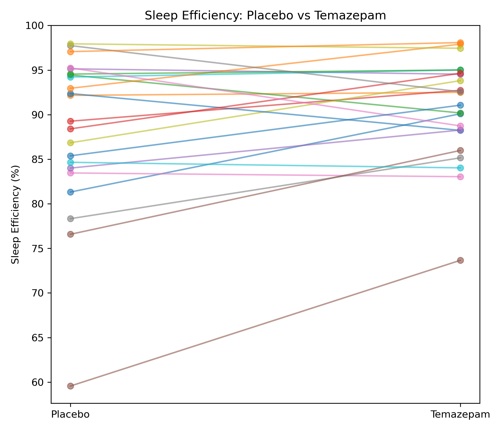
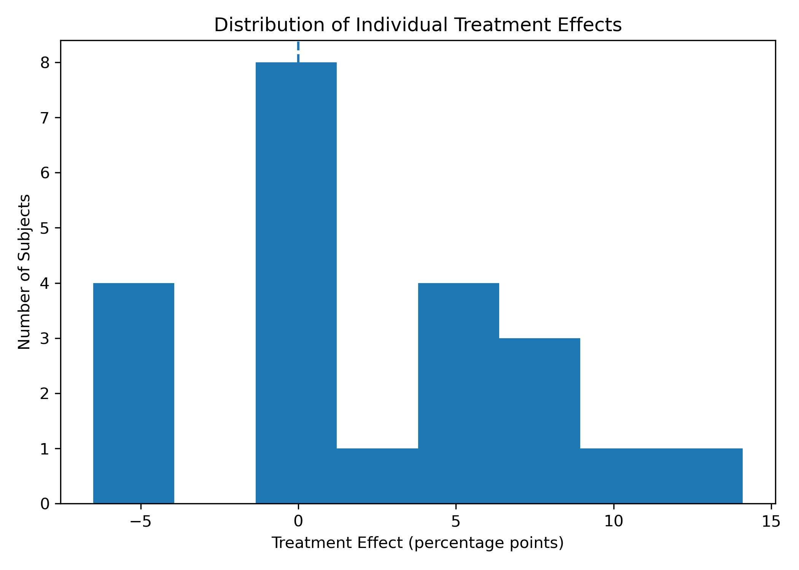
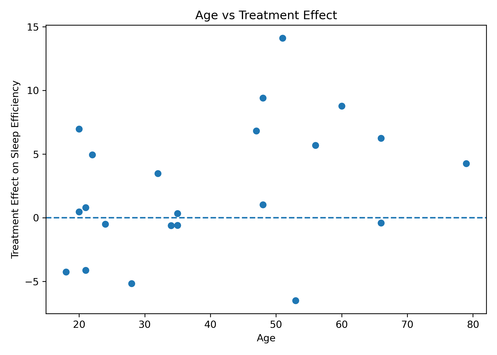

# Cloud-Based Machine Learning for Sleep Treatment Effect Analysis

An exploratory Machine Learning project for estimating individual treatment effects of **Temazepam versus Placebo** on sleep quality and deploying the resulting prediction model as a cloud-ready REST API.

The project combines:

- Sleep data analysis
- Treatment-effect analysis
- Machine Learning
- FastAPI
- Docker
- Cloud deployment concepts
- Public and private cloud infrastructure

> **Important:** This project is an educational and exploratory proof-of-concept.  
> It is not intended for clinical diagnosis, treatment recommendation, or medical decision-making.

---

## Project Overview

This project investigates whether Machine Learning can be used to estimate how sleep outcomes change under **Temazepam treatment compared with Placebo**.

The analysis is based on the **Sleep-EDF Expanded – Sleep Telemetry** dataset from PhysioNet.

Each subject has two recorded nights:

- one **Placebo** night
- one **Temazepam** night

This paired design allows us to calculate an observed treatment effect for each participant.

The main outcome used for the deployed model is:

```text
Treatment Effect =
Sleep Efficiency under Temazepam
-
Sleep Efficiency under Placebo
```

A positive value means that Sleep Efficiency was higher during the Temazepam night.

A negative value means that Sleep Efficiency was lower during the Temazepam night.

---

## Dataset

Dataset:

**Sleep-EDF Expanded – Sleep Telemetry subset**

Source:

https://physionet.org/content/sleep-edfx/1.0.0/

The Sleep Telemetry subset contains:

```text
22 subjects
44 sleep recordings
22 Placebo nights
22 Temazepam nights
```

Each recording contains:

- PSG data
- sleep-stage annotations
- subject metadata
- treatment condition

The raw EDF files are **not included in this repository**.

---

## Data Processing

The processing pipeline extracts sleep-stage information from the hypnogram files and calculates sleep-related features.

The main extracted features include:

```text
Total Recording Time
Total Sleep Time
Sleep Efficiency
Sleep Onset Latency
Wake After Sleep Onset (WASO)
Wake Time
N1 Sleep
N2 Sleep
N3 Sleep
REM Sleep
```

Sleep stages 3 and 4 in the original annotations are combined into modern **N3 / Deep Sleep**.

---

## Treatment Effect Analysis

For each subject, the paired treatment effect is calculated as:

```text
Temazepam outcome - Placebo outcome
```

For Sleep Efficiency, the individual treatment effects showed considerable variability between participants.

```text
Positive treatment effects: 14 subjects
Negative treatment effects: 8 subjects
```

Mean Sleep Efficiency treatment effect:

```text
+2.32 percentage points
```

This variability motivated the exploration of individualized treatment-effect prediction.

---

## Statistical Results

The paired analysis produced the following average differences.

| Outcome | Placebo Mean | Temazepam Mean | Mean Effect |
|---|---:|---:|---:|
| Sleep Efficiency (%) | 88.26 | 90.58 | +2.32 |
| Total Sleep Time (min) | 427.57 | 442.16 | +14.59 |
| Sleep Onset Latency (min) | 23.00 | 17.43 | -5.57 |
| WASO (min) | 41.57 | 32.86 | -8.70 |

A paired Wilcoxon analysis produced:

| Outcome | p-value |
|---|---:|
| Sleep Efficiency | 0.063 |
| Total Sleep Time | 0.144 |
| Sleep Onset Latency | 0.423 |
| WASO | 0.027 |

These results should be interpreted as **exploratory** because of the small sample size and multiple statistical comparisons.

---

## Machine Learning Model

The deployed prediction model uses:

```text
Model: Ridge Regression
Input features:
- Age
- Sex

Target:
Individual Sleep Efficiency Treatment Effect
(Temazepam - Placebo)
```

Only simple pretreatment demographic variables are used in the deployed model.

This avoids using post-treatment outcome information as predictive input.

---

## Model Evaluation

Because the dataset contains only 22 subjects, model evaluation was performed using:

```text
Leave-One-Out Cross-Validation (LOOCV)
```

Results:

```text
MAE  = 4.40 percentage points
RMSE = 5.45 percentage points
R²   = -0.14
```

Mean-effect baseline:

```text
MAE  = 4.52
RMSE = 5.35
R²   = -0.10
```

The negative R² indicates that **Age and Sex alone do not provide strong predictive power for individual treatment-effect heterogeneity**.

This is an important result of the experiment rather than something hidden by the project.

The primary purpose of the deployed model is therefore to demonstrate an end-to-end **Machine Learning + API + Container + Cloud deployment workflow**.

---

## Treatment Effect Distribution

The project contains generated analysis figures inside the `results/` directory.

### Individual Sleep Efficiency Effects



### Treatment Effect Distribution



### Age vs Treatment Effect



---

## System Architecture

The current architecture is:

```text
Sleep-EDF Dataset
        |
        v
Data Preparation
        |
        v
Sleep Feature Extraction
        |
        v
Paired Treatment Analysis
        |
        v
Machine Learning Model
        |
        v
Serialized Model (.joblib)
        |
        v
FastAPI REST API
        |
        v
Docker Container
        |
        v
Public / Private Cloud
```

The project is designed for deployment in both:

```text
Public Cloud
and
Private Cloud / OpenStack
```

---

## REST API

The trained model is exposed using **FastAPI**.

Available endpoints:

| Endpoint | Method | Description |
|---|---|---|
| `/` | GET | Basic API information |
| `/health` | GET | Service health check |
| `/model-info` | GET | Model metadata and limitations |
| `/predict` | POST | Predict treatment effect |

FastAPI automatically provides interactive Swagger documentation at:

```text
http://127.0.0.1:8000/docs
```

---

## Prediction Example

Request:

```json
{
  "age": 48,
  "sex": "Female"
}
```

Example response:

```json
{
  "age": 48,
  "sex": "Female",
  "treatment": "Temazepam",
  "control": "Placebo",
  "predicted_treatment_effect": 2.552,
  "unit": "Sleep Efficiency percentage points",
  "interpretation": "Positive values indicate higher predicted Sleep Efficiency with Temazepam compared with Placebo. Negative values indicate lower predicted Sleep Efficiency.",
  "warning": "Exploratory proof-of-concept only. The model was trained on 22 subjects and is not intended for clinical decisions."
}
```

---

## Project Structure

```text
sleep-treatment-cloud-ml/
│
├── app/
│   └── app.py
│
├── model/
│   ├── model_metadata.json
│   └── treatment_effect_model.joblib
│
├── results/
│   ├── age_vs_treatment_effect.png
│   ├── paired_analysis.csv
│   ├── paired_sleep_efficiency.png
│   ├── statistical_results.csv
│   └── treatment_effect_distribution.png
│
├── src/
│   ├── analyze_effects.py
│   ├── analyze_treatment_effect.py
│   ├── build_cate_dataset.py
│   ├── extract_sleep_features.py
│   ├── prepare_metadata.py
│   ├── train_effect_model.py
│   └── train_final_model.py
│
├── .dockerignore
├── .gitignore
├── Dockerfile
├── requirements.txt
└── README.md
```

---

## Running the API Locally

Install the required Python packages:

```bash
pip install -r requirements.txt
```

Start the FastAPI server:

```bash
python -m uvicorn app.app:app --reload
```

Open:

```text
http://127.0.0.1:8000/docs
```

---

## Running with Docker

Build the Docker image:

```bash
docker build -t sleep-treatment-api .
```

Run the container:

```bash
docker run --rm -p 8000:8000 sleep-treatment-api
```

Then open:

```text
http://127.0.0.1:8000/docs
```

Health check:

```text
GET /health
```

Expected response:

```json
{
  "status": "healthy"
}
```

---

## Docker Architecture

The Docker image contains only the components required to serve the model:

```text
Python Runtime
      +
FastAPI
      +
Machine Learning Dependencies
      +
Trained Model
      +
Model Metadata
```

Large raw EDF dataset files are excluded from the Docker image.

This keeps the deployment environment separate from the research dataset.

---

## Cloud Computing Goal

The project was created as part of a **Modern Cloud Computing Technologies** course.

The cloud component focuses on deploying a Machine Learning inference service and comparing different cloud deployment approaches.

The intended infrastructure includes:

```text
Local Docker
      |
      +---- Public Cloud
      |
      +---- Private Cloud / OpenStack
```

The same containerized application can therefore be deployed across different infrastructure environments.

---

## Public Cloud

A public-cloud deployment is planned as part of the project.

The investigation includes cloud Machine Learning and container deployment technologies such as:

```text
AWS
AWS SageMaker
Kubeflow
Container-based ML deployment
```

The final project will compare public-cloud capabilities with private-cloud deployment.

---

## Private Cloud / OpenStack

The project is also designed for deployment on an OpenStack virtual machine.

Planned deployment architecture:

```text
OpenStack
   |
   v
Virtual Machine
   |
   v
Docker
   |
   v
Sleep Treatment Effect API
   |
   v
Port 8000
   |
   v
Public / Floating IP
```

Actual OpenStack deployment will be added when access to the course OpenStack environment is available.

---

## Reproducibility

The repository separates:

```text
Raw Dataset
Research / Analysis Code
Generated Results
Trained Model
Deployment Application
```

The raw Sleep-EDF files are intentionally excluded from Git because of their size.

They should be downloaded separately from PhysioNet.

The `src/` directory contains the scripts used during the data-processing and model-development workflow.

---

## Limitations

The project has several important limitations:

- The dataset contains only 22 subjects.
- Available pretreatment demographic features are limited.
- Age and Sex alone show weak predictive power.
- The deployed model has negative cross-validation R².
- The analysis is exploratory rather than clinically validated.
- Sleep Efficiency is derived from the available annotated recording period.
- Statistical results should be interpreted cautiously because several outcomes were tested.
- The model must not be used for medical decision-making.

---

## Future Work

Future extensions could include:

```text
Larger datasets
More pretreatment patient features
EEG-derived biomarkers
Advanced heterogeneous treatment-effect models
Causal Forests
Meta-learners
Neural treatment-effect models
Improved validation
Model monitoring
Cloud scalability
Kubeflow pipelines
OpenStack deployment
Public-cloud deployment
```

A larger dataset with richer pretreatment information would be necessary for a more reliable personalized treatment-effect model.

---

## Technologies

```text
Python
Pandas
NumPy
SciPy
Scikit-learn
MNE
Matplotlib
Joblib
FastAPI
Uvicorn
Docker
OpenStack
Cloud Computing
Machine Learning
```

---

## Educational Purpose

This repository demonstrates the complete workflow from:

```text
Medical Sleep Dataset
        ↓
Data Processing
        ↓
Statistical Analysis
        ↓
Machine Learning
        ↓
Model Evaluation
        ↓
REST API
        ↓
Docker
        ↓
Cloud Deployment
```

The emphasis is not only on model performance but also on **reproducibility, containerization, deployment, limitations, and cloud infrastructure**.

---

## Disclaimer

This software is provided for educational and research demonstration purposes only.

It is **not a medical device**, **not a clinical prediction system**, and **must not be used to recommend medication or treatment to patients**.