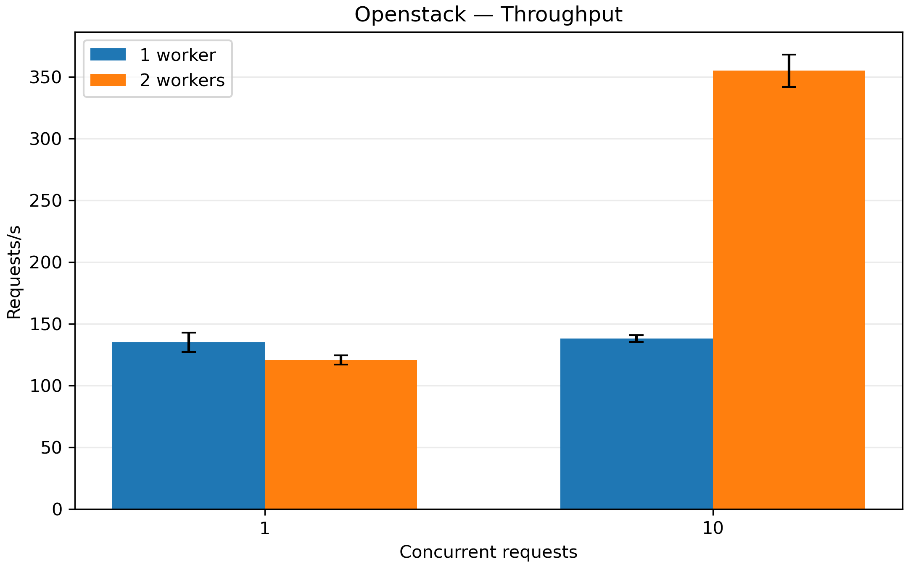
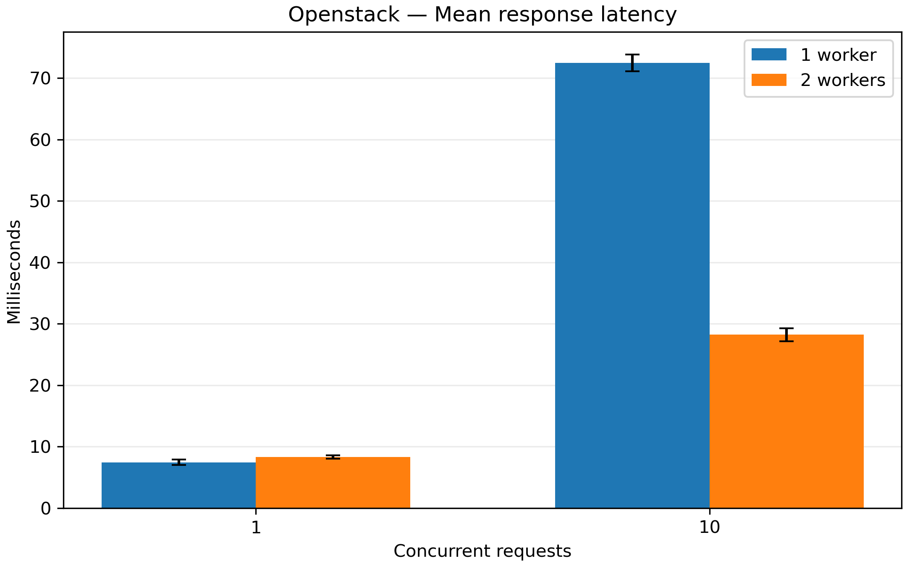
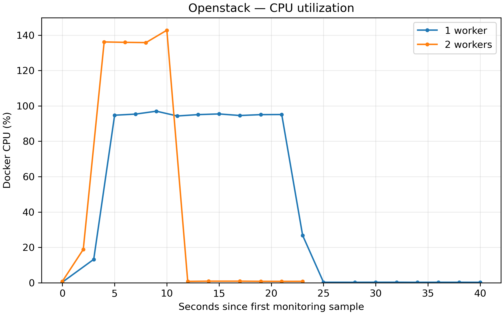

# OpenStack private-cloud experiments

**Experiment date:** 25 November 2026 (UTC)  
**Application:** Sleep Treatment Effect API  
**Application revision:** `273d625` (dependency-pinning commit)  
**Scope:** Private-cloud deployment, functional verification and application-level performance optimization.

## 1. Objective

Evaluate the feasibility and performance of deploying a containerized exploratory machine-learning inference service on OpenStack. Investigate whether increasing the Uvicorn worker count from one to two improves concurrent inference throughput and latency without changing the model or allocating a larger virtual machine. This is the private-cloud baseline for a later public/private-cloud comparison; public-cloud results are not yet available.

## 2. Environment

| Component | Configuration |
|---|---|
| Platform | University OpenStack private cloud |
| Instance | m1.medium, 2 vCPUs, 4 GB RAM, 40 GB provisioned storage |
| Guest OS | Ubuntu 24.04.4 LTS, x86_64, KVM |
| Docker Engine | 29.1.3 |
| Benchmark client | ApacheBench 2.3, running inside the same VM |
| Image | `sleep-treatment-api:v2` (observed build ID `83c4e8ff07c4`) |
| Runtime | Python 3.13.5, FastAPI 0.165.0, Uvicorn 0.54.0 |
| ML libraries | scikit-learn 1.6.1, NumPy 2.1.3, SciPy 1.15.3, pandas 2.2.3, Joblib 1.4.2 |
| Model | StandardScaler + Ridge Regression; age and sex inputs |
| Access | University VPN and SSH local port forwarding; loopback-bound API ports |

The original image loaded a model saved using scikit-learn 1.6.1 with scikit-learn 1.9.1 and produced an inconsistency warning. The corrected image pins the primary runtime dependencies and matches the observed training environment for the main ML packages. Startup logs no longer showed that warning. Transitive dependencies and base-image digest are not fully locked by the Dockerfile, so this does not establish bit-for-bit rebuild reproducibility.

## 3. Deployment and functional verification

The following commands reproduce the tested container setup on an authorized Linux VM with Docker and the repository available. Use fresh container names or check existing containers before running them.

```bash
sudo docker build -t sleep-treatment-api:v2 .
sudo docker run -d --name sleep-treatment-api-v2 --restart unless-stopped \
  -p 127.0.0.1:8002:8000 sleep-treatment-api:v2
sudo docker run -d --name sleep-treatment-api-w2 --restart unless-stopped \
  -p 127.0.0.1:8003:8000 sleep-treatment-api:v2 \
  uvicorn app.app:app --host 0.0.0.0 --port 8000 --workers 2
curl -sS http://127.0.0.1:8003/health
curl -sS -X POST http://127.0.0.1:8003/predict \
  -H 'Content-Type: application/json' -d '{"age":48,"sex":"Female"}'
```

The health check returned HTTP 200 and `{"status":"healthy"}`. The prediction returned HTTP 200 and an estimated effect of +2.552 sleep-efficiency percentage points for the fixed test input. The result matched the local Docker and single-worker tests. The optimized service was also verified through Swagger UI over an SSH tunnel (local port 8001 forwarded to VM loopback port 8003). Only the two-worker container was left running after the comparison; the older containers were stopped and retained for rollback.

The model was trained on 22 subjects and is exploratory. These checks validate execution of the service, not clinical accuracy or suitability for treatment decisions.

## 4. Experimental design

All saved benchmark runs target the VM's loopback interface. The client and server share the VM's CPU resources. The tests exclude VPN, SSH-tunnel and external Internet latency. ApacheBench used its default connection behavior (no explicit keep-alive option). The prediction body was fixed at `{"age":48,"sex":"Female"}`.

| Series | Workload | Runs | Requests |
|---|---|---:|---:|
| Endpoint comparison | 1 worker; health and predict; concurrency 1 and 10; 1,000 requests per run; 3 repetitions each | 12 | 12,000 |
| Worker comparison | Predict; 1 and 2 workers; concurrency 1 and 10; 1,000 requests per run; 3 repetitions each | 12 | 12,000 |
| Initial resource run | 1 worker; predict; concurrency 10; 1,000 requests | 1 | 1,000 |
| Matched resource runs | 1 and 2 workers; predict; concurrency 10; 3,000 requests each | 2 | 6,000 |
| Total archived benchmark dataset | | 27 | 31,000 |

Earlier exploratory runs are excluded from these totals. The repeated tests used five-second pauses between runs. Worker tests alternated one and two workers within each repetition, with no simultaneous benchmark traffic. Both containers remained running during comparison, so idle background overhead was not eliminated. Docker stats were sampled using repeated `--no-stream` calls and one-second sleeps; effective intervals were roughly two to three seconds. Monitoring included periods before and after load. There are 42 saved samples across three monitoring logs.

Example benchmark commands (run only on the authorized test service):

```bash
printf '%s\n' '{"age":48,"sex":"Female"}' > /tmp/sleep-predict.json
ab -n 1000 -c 1 http://127.0.0.1:8002/health
ab -n 1000 -c 10 -p /tmp/sleep-predict.json -T application/json http://127.0.0.1:8002/predict
ab -n 1000 -c 10 -p /tmp/sleep-predict.json -T application/json http://127.0.0.1:8003/predict
sudo -n docker stats --no-stream sleep-treatment-api-v2 sleep-treatment-api-w2
```

The main latency metric is ApacheBench's first `Time per request` value, not its second concurrency-normalized value. Throughput, mean latency and run-level percentiles are summarized with arithmetic means and sample standard deviations. Mean P95 is the mean of the run-level P95 values, not a percentile pooled over all requests. Docker CPU percentages are relative to one logical CPU; approximately 200% corresponds to both vCPUs. Resource peaks are maxima among observed samples, not guaranteed instantaneous maxima.

## 5. Results

### Endpoint comparison (one worker)

| Endpoint | Concurrency | Throughput (req/s) | Mean latency (ms) | Mean P95 (ms) |
|---|---:|---:|---:|---:|
| /health | 1 | 450.16 ± 12.36 | 2.223 ± 0.061 | 3.00 ± 0.00 |
| /health | 10 | 721.61 ± 31.58 | 13.875 ± 0.601 | 18.67 ± 1.15 |
| /predict | 1 | 142.41 ± 10.69 | 7.050 ± 0.553 | 9.00 ± 0.00 |
| /predict | 10 | 133.74 ± 0.64 | 74.772 ± 0.356 | 91.67 ± 1.53 |

The health endpoint benefits from greater concurrency, whereas the single-worker prediction endpoint does not show a throughput improvement under the tested conditions. This motivates application-level parallelization experiments.

### Worker comparison

| Workers | Concurrency | Throughput (req/s) | Mean latency (ms) | Mean P95 (ms) |
|---:|---:|---:|---:|---:|
| 1 | 1 | 134.90 ± 7.83 | 7.430 ± 0.441 | 9.33 ± 0.58 |
| 1 | 10 | 137.98 ± 2.57 | 72.488 ± 1.365 | 87.33 ± 0.58 |
| 2 | 1 | 120.66 ± 3.81 | 8.293 ± 0.260 | 10.00 ± 0.00 |
| 2 | 10 | 354.83 ± 13.22 | 28.209 ± 1.069 | 46.00 ± 1.73 |

At concurrency 10, two workers achieved a 157.15% increase in mean throughput, a 61.08% decrease in mean latency and a 47.33% decrease in mean P95. At concurrency 1, the two-worker configuration had lower observed throughput. The two-worker configuration is therefore preferred for the tested concurrent workload, not universally optimal.



*Figure 1. Prediction throughput by worker count and concurrency. Bars show mean ± sample SD across three 1,000-request runs per configuration.*



*Figure 2. Mean prediction latency by worker count and concurrency. Error bars indicate sample SD across three runs.*

### Matched resource-monitoring experiments

| Metric | 1 worker | 2 workers |
|---|---:|---:|
| Requests | 3,000 | 3,000 |
| Concurrency | 10 | 10 |
| Duration (s) | 20.241 | 8.547 |
| Throughput (req/s) | 148.21 | 351.00 |
| Mean latency (ms) | 67.470 | 28.490 |
| P95 latency (ms) | 86 | 46 |
| P99 latency (ms) | 97 | 55 |
| Peak observed Docker CPU (%) | 96.99 | 142.78 |
| Peak observed RAM (MiB) | 106.8 | 232.1 |
| Peak observed memory utilization (%) | 2.73 | 5.93 |

The matched resource runs show a throughput gain of 136.83%, mean latency reduction of 57.77%, and additional peak memory usage of 125.3 MiB. The CPU observations support improved use of the available vCPUs, without proving the exact source of the performance bottleneck. Across the entire saved dataset, ApacheBench reported zero failed requests and no non-2xx responses.



*Figure 3. Sampled container CPU utilization in separate matched 3,000-request experiments. The time origin is the first monitoring sample for each run, not the precise start of the load. Docker CPU values use 100% per logical CPU.*

## 6. Data and reproducibility

Raw logs are stored in `sleep-cloud-benchmarks/` beside this document. The original archive was verified on both the VM and the Windows client using SHA-256:

`7d4150cebc466aeea52327f856c077b8effb2afd0d24c6f904f8abc660ae1dc0`

From the repository root, using the observed local Python 3.13.5 analysis environment:

```text
python -m pip install -r requirements-analysis.txt
python src/analyze_cloud_benchmarks.py --platform openstack
```

The script validates the archived experiment matrix and produces five CSV files and eight PNG figures in `results/cloud/openstack/analysis/`. The output includes 24 repeated benchmark runs, 3 resource benchmark runs, and 42 resource samples. PNG figures are exported at 300 DPI by the script. The analysis dependency file records Matplotlib 3.10.0 separately from the inference runtime requirements.

## 7. Limitations and next steps

- Three repetitions per repeated configuration and one matched resource run per worker count; no statistical significance claim is made.
- Shared university infrastructure, co-located load generator, fixed request input, and possible background contention limit generalization.
- CPU and memory samples are discrete; the comparison does not measure total energy consumption or exact CPU time per request.
- The benchmarks do not determine maximum capacity, production readiness, autoscaling capability or external network latency.
- HTTP success does not establish that every response had a semantically correct prediction; representative functional tests checked the expected result.
- Public-cloud deployment, network-path latency evaluation, automated provisioning and CI/CD are future work at this stage.
