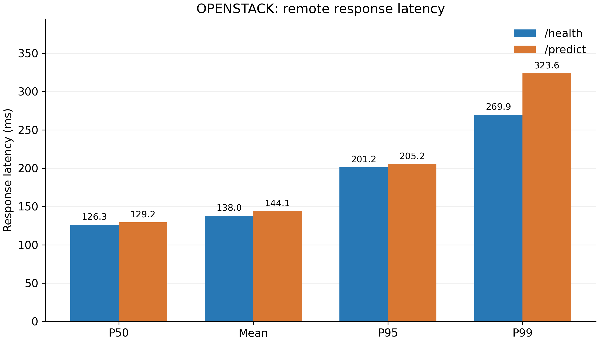
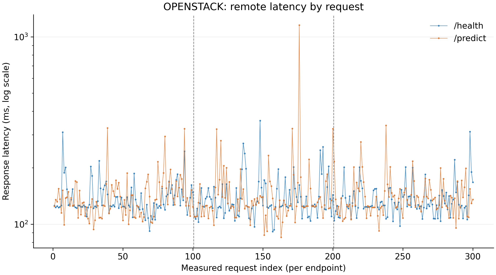
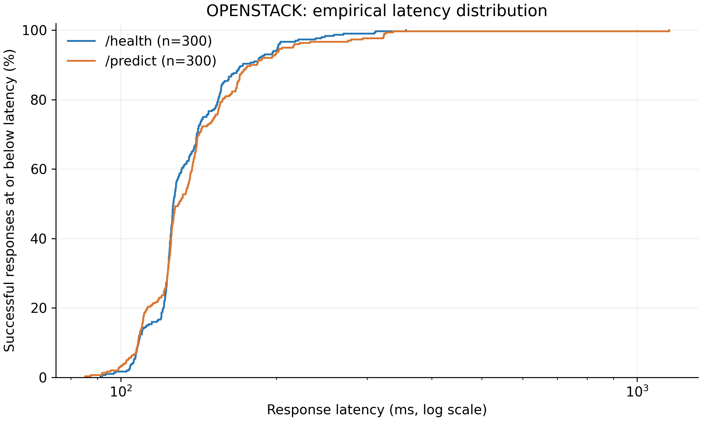

# OpenStack remote API latency experiment

## Objective

Evaluate the end-to-end responsiveness and functional reliability of the containerized sleep treatment effect prediction service when accessed from a Windows laptop through the university VPN and an SSH port-forwarding tunnel. This supplements the internal ApacheBench experiments documented in [OPENSTACK_EXPERIMENTS.md](../OPENSTACK_EXPERIMENTS.md).

## Experimental setup

- Date: 25 November 2026; recorded start: 14:17:20 UTC.
- Server: university OpenStack, Ubuntu 24.04, 2 vCPUs, 4 GB RAM, 40 GB storage; Docker and FastAPI with two Uvicorn workers, using the pinned runtime introduced in commit `273d625`.
- Client: Windows laptop, Python standard-library HTTP client (`urllib.request`), proxies disabled in the client. Connection through OpenVPN and SSH forwarding to the container's loopback-bound host port. No direct public API port required.
- Endpoints: GET `/health` and POST `/predict` with the fixed synthetic payload `{"age":48,"sex":"Female"}`.
- Each endpoint: three runs of 100 sequential measured requests (concurrency 1); five warm-up requests per run, plus a preflight request per endpoint. A two-second pause follows each run. Timeout setting: 10 seconds per HTTP operation.
- The client requires HTTP 200 and validates the expected health response or prediction value (2.552 percentage points, tolerance less than 0.0005). This tests consistency of inference, not clinical accuracy.
- Fresh HTTP requests without persistent connection reuse; elapsed time measured from immediately before opening the request through full response-body read, including response closure, before JSON validation. Request construction is outside the measured interval. Throughput is validated successful responses divided by measured run wall time, excluding warm-ups and pauses.
- Aggregated latency statistics use the pooled successful request observations for each endpoint; SD is the sample standard deviation of those observations; percentiles use the nearest-rank method. Endpoints were tested in fixed order (health then prediction).

## Results

| Metric | /health | /predict |
|---|---:|---:|
| Measured requests | 300 | 300 |
| Successful | 300 | 300 |
| Failed / non-2xx / transport errors | 0 / 0 / 0 | 0 / 0 / 0 |
| Measured run wall time (s, summed) | 41.442507 | 43.258578 |
| Throughput (requests/s) | 7.238944 | 6.935041 |
| Mean latency (ms) | 138.031166 | 144.068327 |
| Sample SD (ms) | 33.798069 | 70.755001 |
| P50 (ms) | 126.2895 | 129.2387 |
| P95 (ms) | 201.2311 | 205.1624 |
| P99 (ms) | 269.8691 | 323.6348 |
| Maximum (ms) | 356.6126 | 1153.6548 |

The three run-level mean latencies for health were 138.189, 140.392 and 135.512 ms; for prediction they were 140.913, 150.406 and 140.887 ms. All 600 measured requests succeeded. Warm-up and preflight requests are excluded. With 31,000 saved internal benchmark requests, the total number of measured requests in the two distinct experimental series is 31,600.

## Figures



**Figure 1.** P50, mean, P95 and P99 of pooled successful remote requests, in milliseconds (300 per endpoint). Maximum latency is reported separately in the table.



**Figure 2.** Individual successful response latencies in measured request order, with a logarithmic vertical axis to retain the long-latency observations. Dashed vertical lines separate repetitions. Indices are per endpoint, not synchronized timestamps.



**Figure 3.** Empirical cumulative distribution of successful response latencies for each endpoint. The horizontal axis is logarithmic; the vertical axis is the percentage of observations at or below each latency.

## Interpretation and limitations

The mean prediction response was 6.037 ms higher than the health response. This is a descriptive end-to-end difference, not an isolated measurement of model computation or a statistically established effect. The prediction endpoint had greater dispersion and a maximum of approximately 1.154 seconds; this observation is retained. The experiment does not identify the cause of the long response.

Internal ApacheBench and remote Python results must be interpreted separately: client tools, transport paths, worker configurations in some earlier tests, and connection behavior differ. Remote throughput is sequential observed throughput, not maximum server capacity. The latency includes client/transport overhead, VPN and SSH forwarding, API processing and response transfer; it does not measure pure network latency. Fixed test order, a single laptop and session, a single synthetic payload, shared cloud infrastructure, and three repetitions per endpoint limit generalizability. Zero observed failures does not guarantee future availability. No clinical conclusions are drawn.

For public-cloud comparison, use the same benchmark script, laptop, request counts, payload, worker count and latency definition; record region, client network, date, access path and differences in VPN/SSH configuration. If paths differ, compare end-to-end access performance for the measured deployments, not intrinsic cloud networking performance.

## Reproduction

From the repository root (Windows CMD), with the authorized OpenStack SSH tunnel already configured on local port 8001:

```cmd
python src\benchmark_remote_api.py --platform openstack --url http://127.0.0.1:8001 --output results\cloud\openstack\remote_latency_repeat
python -m pip install -r requirements-analysis.txt
python src\analyze_remote_latency.py --platform openstack
```

The first command writes a new experiment to avoid overwriting the original. The last command plots the saved original experiment; add `--input results\cloud\openstack\remote_latency_repeat` to plot the new run instead. Record any changed configuration separately. No credentials or VPN configuration are required in the repository.

Original data: [individual requests](remote_requests.csv), [run summaries](remote_run_summary.csv), [endpoint summary](remote_endpoint_summary.csv), [configuration](benchmark_config.json).
